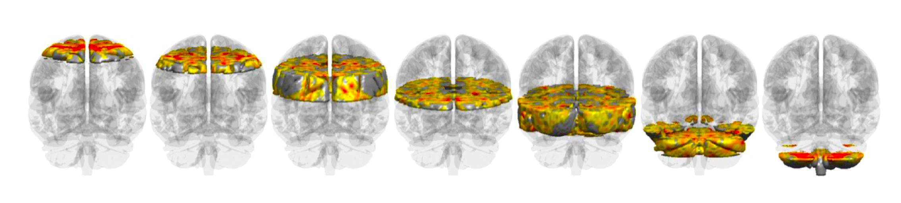

===============================
VoxelWise Toolbox Documentation
===============================

**VoxelWise Toolbox** is a lightweight, dependency-free MATLAB library for human
fMRI analysis, built on a single architectural principle: the brain is one fixed
voxel-wise vector, used by every function.

Any function therefore composes with any other, without data wrapping, format
conversion or framework-specific structures. It complements existing
preprocessing pipelines rather than replacing them, and is aimed particularly at
continuous-feature and naturalistic paradigms, where the discrete-event
assumptions of conventional designs do not hold.

.. Both .svg and .png are shipped and the extension is left as ".*" on
   purpose: Sphinx picks the SVG for HTML and the PNG for the PDF build,
   which cannot embed SVG.

.. figure:: _static/toolbox_schematic.*
   :align: center
   :width: 100%
   :alt: One data layout shared by eighty-three functions in eight modules

   Every function reads and writes the same layout, so the modules below can
   be combined in any order.

.. code-block:: matlab

   [vol, ~] = fmri_readnii('sub-01_bold.nii');
   data     = fmri_vol2vect(vol);          % 228453 x T, from here on
   data     = fmri_detrend(data, 6);
   r_map    = fmri_corregressor(regressor, data);
   fmri_showslices(r_map, 1, 2, [-0.6 0.6]);

   Drawn by :doc:`modules/fmri_braincake`, one of nineteen display functions,
   all of which take the same ``228453 x 1`` vector the analysis functions
   return.

.. note::

   All example data in these pages is synthetic unless a page says otherwise.
   The demos that use simulated cohorts run end to end with no scanner data.

At a glance
===========

================================  ==========================================
83 public functions               eight composable modules
19 atlas maps                     from ten published sources
0 compiled files                  base MATLAB R2019a or later
no MathWorks toolboxes            no SPM
================================  ==========================================

.. toctree::
   :maxdepth: 2
   :caption: Quick Start

   gettingstarted/index

.. toctree::
   :maxdepth: 1
   :caption: Function Documentation
   :titlesonly:

   modules/index

.. toctree::
   :maxdepth: 2
   :caption: Tutorials

   demos/index

Citing
======

If you use the toolbox, please cite the paper and the archived release.

Burunat, I., Alluri, V. & Toiviainen, P. (in preparation, 2026). *VoxelWise
Toolbox: transparent and composable fMRI analysis in base MATLAB.*

Additional resources
====================

- Project site: `voxelwise-toolbox <https://voxelwise-toolbox.readthedocs.io>`_
- Source code: `VoxelWise-Toolbox on GitHub <https://github.com/iburunat/VoxelWise-Toolbox>`_
- Licence: `MIT <https://opensource.org/licenses/MIT>`_
- Developed at the `University of Jyväskylä <https://www.jyu.fi/en>`_
